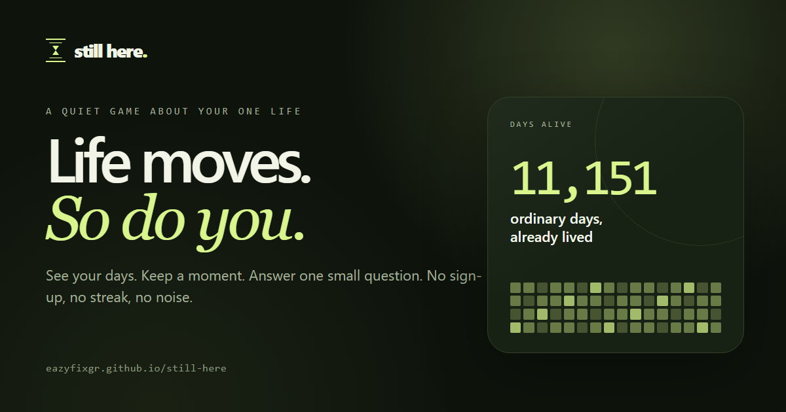

# Still Here

A quiet, local-first game about the time you have. See your life in days, keep a few milestones, answer one small question, and leave messages for your future self.

Live site: **https://eazyfixgr.github.io/still-here/**



## What it does

- A fixed, time-based game scenario built from population life-expectancy data and fictional lifestyle rules.
- A live countdown with calendar years, months, days, hours, minutes, and seconds.
- Automatic milestones for time, lived days, birthdays, scenario progress, and Overtime.
- Custom milestones chosen by the player.
- One private question per day, with a local-only answer.
- Shareable PNG cards for a square post or a story, made on the device with no birth date, country, or private note.
- Public question links (`?moment=YYYY-MM-DD`) that carry the language and the day, without exposing personal data.
- Time capsules: sealed messages that unlock on a future date, with an `.ics` reminder.
- A scenario lab for comparing a different rhythm without changing the active clock.
- English and Greek interfaces, with English as the default.
- Night and daylight themes, reduced-motion support, accessible dialogs, and a responsive mobile layout.
- Local JSON backup export and import.
- Automatic migration of saves from the original single-file prototype.
- Installable app shell with offline caching via a service worker.

## Privacy

This version intentionally has **no cloud backend**. Profile details, progress, milestones, capsules, private answers, and preferences live in `localStorage` on the current device. Nothing is sent to a server.

Share cards are rendered locally with Canvas and contain only the chosen public fact, a short caption, the app link, and a QR code. Your birth date, country, and private notes are never printed. The public question links contain only a date, a language code, and the app URL.

The persistence layer is isolated in `src/core/persistence.js`, so an encrypted sync provider can be added later without changing the UI or the game model. Until then, use **Settings → Export backup** to keep a private copy or move a journey to another device.

## Development

```bash
npm install
npx playwright install chromium
npm run dev
npm test
npm run test:e2e
npm run build
```

`npm run verify` runs unit tests, browser tests, and a production build.

The production build uses the GitHub Pages project path `/still-here/` by default. Set `BASE_PATH` to override it:

```bash
BASE_PATH=/my-path/ npm run build
```

## Project structure

```text
src/
  app.js                 application shell, routing, actions, ticker
  main.js                boot, launch links, service worker
  config.js              public URLs and release label
  core/                  model, dates, moments, sharing, calendar, storage, i18n
  data/                  country baselines and fictional lifestyle weights
  ui/                    onboarding, dashboard, share cards, views, components
  styles/                modular CSS
e2e/                     Playwright browser and accessibility tests
tests/                   unit and model tests
legacy/                  the original single-file prototype
```

## Model and data

Population life expectancy at birth by sex comes from Eurostat table `demo_mlexpec` for 2024. A synthetic Gompertz survival shape is used to produce an age-aware game baseline. Lifestyle choices carry fictional points, combined into a multiplier of `exp(points / 70)`.

The countdown is a **fictional game scenario**, not a medical assessment, individual life table, or prediction of death. Population averages cannot predict an individual life. Habit points are not years gained or lost in real life. The endpoint is fixed when a journey starts.

Eurostat source: <https://ec.europa.eu/eurostat/databrowser/view/demo_mlexpec/default/table?lang=en>

The original prototype used Greek ELSTAT 2024 figures, which match the Eurostat 2024 series used here.

## Sharing

The share sheet can export:

- a square or story layout;
- a night, paper, or ember palette;
- days alive, today's question, or a collected milestone;
- a generated PNG and ready-to-copy caption.

Native sharing is used on supported phones. Other browsers download the PNG. The public link opens in the chosen language and, for question cards, the matching date.

## Deployment

Pushing to `main` runs the `Deploy to GitHub Pages` workflow. It installs dependencies, runs unit tests, installs Chromium, runs Playwright browser and accessibility checks, builds the site with the correct repository base path, and publishes `dist/` through GitHub Pages.
